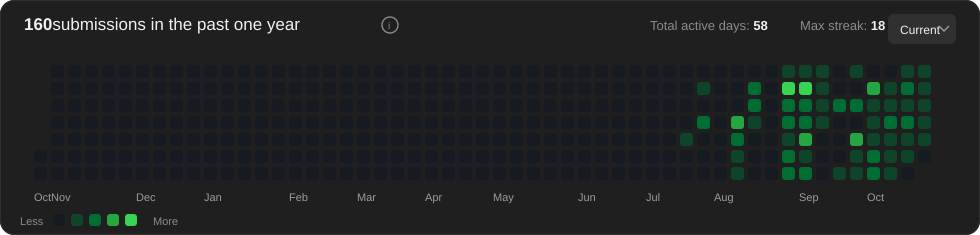

# 🧑‍💻 Satish's LeetCode Journey

  

  <b>Daily LeetCode practice, automatically tracked through GitHub.</b>
   
  Accepted solutions synced by LeetSync are reflected in this dashboard.

---

## ⚡ Quick Overview

| 🧩 Solved | 🟢 Easy | 🟡 Medium | 🔴 Hard | 🔥 Streak | 🏆 Best Streak |
|---:|---:|---:|---:|---:|---:|
| **110** | **84** | **24** | **2** | **1 days** | **18 days** |

---

## 📊 LeetCode Statistics

| Metric | Value |
|---|---:|
| 🧩 **Problems Solved** | **110** |
| 🟢 Easy | 84 / 972 |
| 🟡 Medium | 24 / 2,130 |
| 🔴 Hard | 2 / 984 |
| 🎯 Acceptance Rate | **76.9%** |
| 🔥 Current Streak | **1 days** |
| 🏆 Longest Streak | **18 days** |
| 📅 Active Days | **54** |
| 📁 Problems in Repository | **43** |

### Difficulty Progress

| Difficulty | Progress | Completion |
|---|---|---:|
| 🟢 Easy | `██░░░░░░░░░░░░░░░░░░░░░░` | 8.6% |
| 🟡 Medium | `░░░░░░░░░░░░░░░░░░░░░░░░` | 1.1% |
| 🔴 Hard | `░░░░░░░░░░░░░░░░░░░░░░░░` | 0.2% |

## 🏁 Contest Profile

| Rating | Global Rank | Top Percentage | Contests |
|---:|---:|---:|---:|
| **1,413** | **689,196** | **77.89%** | **1** |

## 🕐 Recently Added

| Problem | Difficulty | Date |
|---|---|---|
| [74. Search a 2D Matrix](./74-search-a-2d-matrix) | 🟡 Medium | 2026-10-15 |
| [203. Remove Linked List Elements](./203-remove-linked-list-elements) | 🟢 Easy | 2026-10-15 |
| [18. 4Sum](./18-4sum) | 🟡 Medium | 2026-10-13 |
| [11. Container With Most Water](./11-container-with-most-water) | 🟡 Medium | 2026-10-12 |
| [15. 3Sum](./15-3sum) | 🟡 Medium | 2026-10-12 |
| [485. Max Consecutive Ones](./485-max-consecutive-ones) | 🟢 Easy | 2026-10-12 |
| [1482. How Many Numbers Are Smaller Than the Current Number](./1482-how-many-numbers-are-smaller-than-the-current-number) | 🟢 Easy | 2026-10-12 |
| [2844. Sum of Squares of Special Elements ](./2844-sum-of-squares-of-special-elements) | 🟢 Easy | 2026-10-12 |
| [633. Sum of Square Numbers](./633-sum-of-square-numbers) | 🟡 Medium | 2026-10-07 |
| [957. Minimum Add to Make Parentheses Valid](./957-minimum-add-to-make-parentheses-valid) | 🟡 Medium | 2026-10-07 |

## 🧩 Problems Solved

### 🟢 Easy (27)

| # | Problem | Topics | Solution | Date |
|---:|---|---|---|---|
| 20 | **Valid Parentheses** | String, Stack, Bracket Sequences | [Open](./20-valid-parentheses) | 2026-10-02 |
| 66 | **Plus One** | Array, Math | [Open](./66-plus-one) | 2026-09-28 |
| 125 | **Valid Palindrome** | Two Pointers, String | [Open](./125-valid-palindrome) | 2026-09-22 |
| 136 | **Single Number** | Array, Bit Manipulation | [Open](./136-single-number) | 2026-09-08 |
| 203 | **Remove Linked List Elements** | Linked List, Recursion | [Open](./203-remove-linked-list-elements) | 2026-10-15 |
| 205 | **Isomorphic Strings** | Hash Table, String | [Open](./205-isomorphic-strings) | 2026-09-24 |
| 219 | **Contains Duplicate II** | Array, Hash Table, Sliding Window | [Open](./219-contains-duplicate-ii) | 2026-09-15 |
| 350 | **Intersection of Two Arrays II** | Array, Hash Table, Two Pointers, Binary Search | [Open](./350-intersection-of-two-arrays-ii) | 2026-09-19 |
| 387 | **First Unique Character in a String** | Hash Table, String, Queue, Counting | [Open](./387-first-unique-character-in-a-string) | 2026-09-28 |
| 389 | **Find the Difference** | Hash Table, String, Bit Manipulation, Sorting | [Open](./389-find-the-difference) | 2026-09-30 |
| 414 | **Third Maximum Number** | Array, Sorting | [Open](./414-third-maximum-number) | 2026-10-02 |
| 485 | **Max Consecutive Ones** | Array | [Open](./485-max-consecutive-ones) | 2026-10-12 |
| 541 | **Reverse String II** | Two Pointers, String | [Open](./541-reverse-string-ii) | 2026-10-03 |
| 861 | **Flipping an Image** | Array, Two Pointers, Bit Manipulation, Matrix | [Open](./861-flipping-an-image) | 2026-10-03 |
| 1406 | **Subtract the Product and Sum of Digits of an Integer** | Math | [Open](./1406-subtract-the-product-and-sum-of-digits-of-an-integer) | 2026-09-07 |
| 1444 | **Number of Steps to Reduce a Number to Zero** | Math, Bit Manipulation | [Open](./1444-number-of-steps-to-reduce-a-number-to-zero) | 2026-09-27 |
| 1482 | **How Many Numbers Are Smaller Than the Current Number** | Array, Hash Table, Sorting, Counting Sort | [Open](./1482-how-many-numbers-are-smaller-than-the-current-number) | 2026-10-12 |
| 1833 | **Find the Highest Altitude** | Array, Prefix Sum | [Open](./1833-find-the-highest-altitude) | 2026-09-28 |
| 1950 | **Sign of the Product of an Array** | Array, Math | [Open](./1950-sign-of-the-product-of-an-array) | 2026-09-28 |
| 2427 | **First Letter to Appear Twice** | Hash Table, String, Bit Manipulation, Counting | [Open](./2427-first-letter-to-appear-twice) | 2026-09-27 |
| 2502 | **Sort the People** | Array, Hash Table, String, Sorting | [Open](./2502-sort-the-people) | 2026-09-19 |
| 2844 | **Sum of Squares of Special Elements ** | Array, Enumeration | [Open](./2844-sum-of-squares-of-special-elements) | 2026-10-12 |
| 3321 | **Type of Triangle** | Array, Math, Sorting, Polygons | [Open](./3321-type-of-triangle) | 2026-09-28 |
| 3811 | **Reverse Degree of a String** | String, Simulation | [Open](./3811-reverse-degree-of-a-string) | 2026-09-20 |
| 3869 | **Smallest Index With Digit Sum Equal to Index** | Array, Math | [Open](./3869-smallest-index-with-digit-sum-equal-to-index) | 2026-09-24 |
| 4245 | **Count Commas in Range** | Math | [Open](./4245-count-commas-in-range) | 2026-09-08 |
| 4410 | **Count Integers Appearing in a Single Block** | Array, Hash Table, Counting | [Open](./4410-count-integers-appearing-in-a-single-block) | 2026-09-24 |

### 🟡 Medium (15)

| # | Problem | Topics | Solution | Date |
|---:|---|---|---|---|
| 11 | **Container With Most Water** | Array, Two Pointers, Greedy | [Open](./11-container-with-most-water) | 2026-10-12 |
| 15 | **3Sum** | Array, Two Pointers, Sorting | [Open](./15-3sum) | 2026-10-12 |
| 18 | **4Sum** | Array, Two Pointers, Sorting | [Open](./18-4sum) | 2026-10-13 |
| 33 | **Search in Rotated Sorted Array** | Array, Binary Search | [Open](./33-search-in-rotated-sorted-array) | 2026-10-02 |
| 50 | **Pow(x, n)** | Math, Recursion | [Open](./50-powx-n) | 2026-10-03 |
| 53 | **Maximum Subarray** | Array, Divide and Conquer, Dynamic Programming | [Open](./53-maximum-subarray) | 2026-09-29 |
| 74 | **Search a 2D Matrix** | Array, Binary Search, Matrix | [Open](./74-search-a-2d-matrix) | 2026-10-15 |
| 75 | **Sort Colors** | Array, Two Pointers, Sorting, Quicksort | [Open](./75-sort-colors) | 2026-09-06 |
| 137 | **Single Number II** | Array, Bit Manipulation | [Open](./137-single-number-ii) | 2026-09-24 |
| 167 | **Two Sum II - Input Array Is Sorted** | Array, Two Pointers, Binary Search | [Open](./167-two-sum-ii-input-array-is-sorted) | 2026-09-22 |
| 260 | **Single Number III** | Array, Bit Manipulation | [Open](./260-single-number-iii) | 2026-09-24 |
| 633 | **Sum of Square Numbers** | Math, Two Pointers, Binary Search | [Open](./633-sum-of-square-numbers) | 2026-10-07 |
| 882 | **Peak Index in a Mountain Array** | Array, Binary Search, Ternary Search | [Open](./882-peak-index-in-a-mountain-array) | 2026-09-25 |
| 957 | **Minimum Add to Make Parentheses Valid** | String, Stack, Greedy, Bracket Sequences | [Open](./957-minimum-add-to-make-parentheses-valid) | 2026-10-07 |
| 4285 | **Smallest Stable Index II** | Array, Prefix Sum | [Open](./4285-smallest-stable-index-ii) | 2026-09-06 |

### 🔴 Hard (1)

| # | Problem | Topics | Solution | Date |
|---:|---|---|---|---|
| 154 | **Find Minimum in Rotated Sorted Array II** | Array, Binary Search | [Open](./154-find-minimum-in-rotated-sorted-array-ii) | 2026-09-09 |

## 🧠 Top Topics

| Topic | Problems |
|---|---:|
| Array | 28 |
| Two Pointers | 10 |
| String | 10 |
| Sorting | 9 |
| Math | 9 |
| Hash Table | 9 |
| Binary Search | 7 |
| Bit Manipulation | 7 |
| Counting | 3 |
| Greedy | 2 |
| Stack | 2 |
| Bracket Sequences | 2 |
| Recursion | 2 |
| Matrix | 2 |
| Simulation | 2 |

## 💻 Languages Used

| Language | Solutions |
|---|---:|
| Java | 41 |
| Python | 1 |

## 📅 Last 30 Days

| Date | Submissions |
|---|---:|
| 2026-09-19 | 2 |
| 2026-09-20 | 1 |
| 2026-09-21 | 0 |
| 2026-09-22 | 4 |
| 2026-09-23 | 0 |
| 2026-09-24 | 6 |
| 2026-09-25 | 1 |
| 2026-09-26 | 2 |
| 2026-09-27 | 0 |
| 2026-09-28 | 8 |
| 2026-09-29 | 2 |
| 2026-09-30 | 1 |
| 2026-10-01 | 1 |
| 2026-10-02 | 4 |
| 2026-10-03 | 4 |
| 2026-10-04 | 0 |
| 2026-10-05 | 1 |
| 2026-10-06 | 1 |
| 2026-10-07 | 3 |
| 2026-10-08 | 1 |
| 2026-10-09 | 2 |
| 2026-10-10 | 1 |
| 2026-10-11 | 2 |
| 2026-10-12 | 3 |
| 2026-10-13 | 1 |
| 2026-10-14 | 3 |
| 2026-10-15 | 1 |
| 2026-10-16 | 1 |
| 2026-10-17 | 0 |
| 2026-10-18 | 1 |

---

## 🔗 Profiles

- 🟧 [LeetCode](https://leetcode.com/u/kl2400030372/)
- 🐙 [GitHub](https://github.com/kl2400030372)

---

  
    🤖 Automatically updated by GitHub Actions
     
    Last update: 18 Oct 2026, 20:57
  

